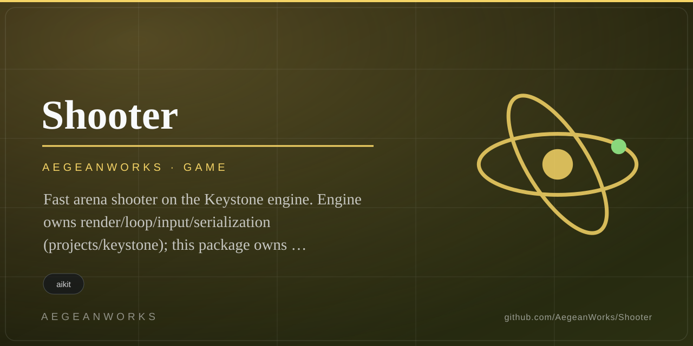

# Shooter (Keystone plug-in)

<!-- aegean:media:start -->
<p align="center"></p>
<p align="center"><a href="LICENSE"></a> <a href="https://github.com/AegeanWorks/AIKit"></a></p>
<!-- aegean:media:end -->


Fast arena shooter on the Keystone engine. Engine owns render/loop/input/serialization (`projects/keystone`); this package owns state/rules/scene and loads via `--game shooter.game:ShooterGame`.

## 30-Second Cold-Start Quick Reference

- **Runtime Prerequisites**: Python 3.10+, Keystone pinned stack (numpy 2.5.3, PyOpenGL 3.1.10, glfw 2.11.0, pytest 9.1.1); OpenGL 3.3-capable GPU for rendered runs (headless sim needs no GPU).
- **One-click start**: double-click `start-shooter.cmd` (Windows) or run `./start-shooter.sh` (macOS/Linux).
- **Canonical Regression Shield Gate**:
  ```powershell
  # from projects/shooter
  python -m pytest -q
  ```

## One-click start

Double-click `start-shooter.cmd` (Windows) or run `./start-shooter.sh`
(macOS/Linux) — no terminal setup, no `PYTHONPATH`. It launches the live
windowed game via `play.py`:

```powershell
# from anywhere; extra args pass straight to Keystone
python projects/shooter/play.py
python projects/shooter/play.py --simulate --frames 600
python projects/shooter/play.py --describe
```

`play.py` resolves its own folder, adds `projects/shooter` +
`projects/keystone` to `sys.path`, checks Python 3.10+ and the sibling
Keystone checkout, then runs `keystone --game shooter.game:ShooterGame`.

## Prerequisites

- Python 3.10+, Keystone pinned stack (numpy 2.5.3, PyOpenGL 3.1.10, glfw 2.11.0, pytest 9.1.1)
- OpenGL 3.3-capable GPU driver for rendered runs (headless sim needs no GPU)

## Test

```powershell
# from projects/shooter
python -m pytest -q
# engine gate (from projects/keystone)
python -m pytest -q
# headless bot proofs (no GPU)
$env:PYTHONPATH="C:\Users\Yunus-Emre\Desktop\portable_agent_kit\projects\keystone;C:\Users\Yunus-Emre\Desktop\portable_agent_kit\projects\shooter"
python -m keystone --game shooter.game:ShooterGame --describe
python -m keystone --game shooter.game:ShooterGame --simulate --frames 600 --trace
python -m keystone --game shooter.game:ShooterGame --verify-determinism --frames 1800
python -m keystone --game shooter.game:ShooterGame --headless --frames 1 --size 960x540 --ui --out shot.png --report shot.json
```

## What's Inside

```text
projects/shooter/
├── shooter/
│   ├── __init__.py      <- plug-in exports
│   ├── game.py          <- ShooterGame: five ops + draw_ui, Scene sync, mixer
│   ├── sim.py           <- deterministic sim: move/weapons/enemies/waves/particles/engagement
│   ├── bot.py           <- headless bot scripts (move/fire/assault/kite/overdrive_step)
│   ├── ui.py            <- crosshair/HP/ammo/score/streak/overdrive overlay
│   └── data/
│       ├── weapons.json    <- 4 guns (pulse/scatter/lance/surge)
│       ├── enemies.json    <- mite/brute/wisp
│       ├── levels.json     <- arena + 5 waves + pickup + win_wave
│       ├── juice.json      <- tracer/flash/particle caps, hitstop
│       ├── engagement.json <- reward/streak/near-miss/overdrive tuning
│       └── grade.json      <- renderer flags adopted as DATA
├── tests/
│   ├── conftest.py         <- adds keystone + shooter to sys.path
│   ├── test_shooter.py     <- move/shoot/hit/kill/die/score/determinism/budget
│   ├── test_engagement.py  <- odds/stream/overdrive/lock/determinism
│   └── test_audit.py       <- wave-1/2 audit regression pins
├── scripts/
│   ├── record_bot.py  <- emit CommandLog for --replay
│   ├── soak.py        <- full-length sustain soak + timing/budget report
│   └── capture.py     <- seeded screenshot routes (spawn/combat/burst/pickup/death)
├── play.py                 <- one-click launcher (path setup + game start, passes args through)
├── start-shooter.cmd       <- Windows double-click entry point (python/play.py)
├── start-shooter.sh        <- macOS/Linux entry point (python3 play.py)
├── .gitignore              <- bytecode, caches, session evidence
├── README.md               <- this file
├── LICENSE                 <- Aegean Game License 1.1 (personal play)
├── LICENSES/               <- machine-readable license texts (REUSE)
├── COMMERCIAL.md            <- paid use terms (ACL-1.0)
├── ASSETS.md                <- asset provenance for packs/ports
├── REUSE.toml               <- copyright + license inventory
├── assets/                 <- logo.svg + social-preview.svg (brand)
├── bot_kite600.json        <- scripted kite reference (fair `witnessed_win`)
├── bot_log.json            <- command-log sample
├── bot_soak.json           <- sustain soak script
├── bot_soak2.json          <- second sustain soak script
├── bot_strafe.json         <- strafe drill script
├── soak_report.json        <- sustain evidence trail
├── soak_report2.json       <- second sustain evidence trail
├── spin_actions.json       <- spin action sample
├── shot_combat.json        <- headless combat capture report
├── shot_combat.png         <- headless combat capture image
├── shot_fix_burst.json     <- burst capture report
├── shot_fix_burst.png      <- burst capture image
├── shot_fix_combat.json    <- combat capture report
├── shot_fix_combat.png    <- combat capture image
├── shot_fix_death.json     <- death capture report
├── shot_fix_death.png      <- death capture image
├── shot_fix_pickup.json    <- pickup capture report
├── shot_fix_pickup.png     <- pickup capture image
├── shot_fix_spawn.json     <- spawn capture report
├── shot_fix_spawn.png      <- spawn capture image
├── shot_min1.json          <- minute-1 capture report
├── shot_min1.png           <- minute-1 capture image
├── shot_soak.json          <- soak capture report
├── shot_soak.png           <- soak capture image
├── shot_stage4_min1.json   <- stage-4 capture report
├── shot_stage4_min1.png    <- stage-4 capture image
├── shot_stage4_min30proxy.json <- stage-4 proxy capture report
├── shot_stage4_min30proxy.png  <- stage-4 proxy capture image
└── .aikit/
    ├── decisions.md     <- append-only ADRs
    ├── guidelines.md    <- agent working agreement
    ├── project.json     <- project metadata
    ├── media.json       <- brand/media manifest
    └── task_ledger.json <- disruption-recovery ledger
```

## Controls (live Engine bindings)

Live play uses the Engine's default key map only — the Engine builds a
plain `InputMap()` with no per-game bindings hook, so just these reach
the sim: W/S forward/back, A/D strafe, E jump, mouse look, left-click
fire (one shot per click). `1/2/3` weapon slots, `R` reload, and voluntary
overdrive have no live key binding yet (engine-side gap, filed — see
ADR-016); drive them via headless `ActionState` scripts (`shooter.bot`
kite/overdrive policies), `--replay` logs, or the `bot_kite600.json`
reference. Shift sprint, P pause, H hide UI, F1 cursor, Esc quit.

<!-- aegean:brand-assets:start -->
## 🎨 Brand Assets

> **AI-Generated Brand Artwork.** The banner and logo are **AI-generated brand assets**. They are illustrative and may not literally depict every feature or the full project scope.
<!-- aegean:brand-assets:end -->

## 📜 License

<!-- aegean:license:start -->
Free for personal play under the Aegean Game License 1.1 (AGL-1.1); see [LICENSE](LICENSE). It is DRM-free: Licensor ships no DRM and a distributor may not add it. Streaming, modding and free mods are allowed. Commercial use, paid mods and AI training need the Aegean Commercial License 1.0 (ACL-1.0); see [COMMERCIAL.md](COMMERCIAL.md).
<!-- aegean:license:end -->
